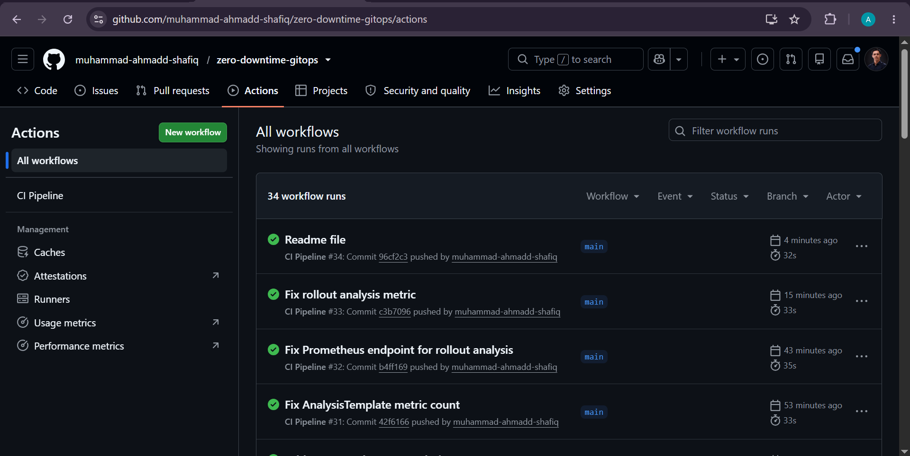
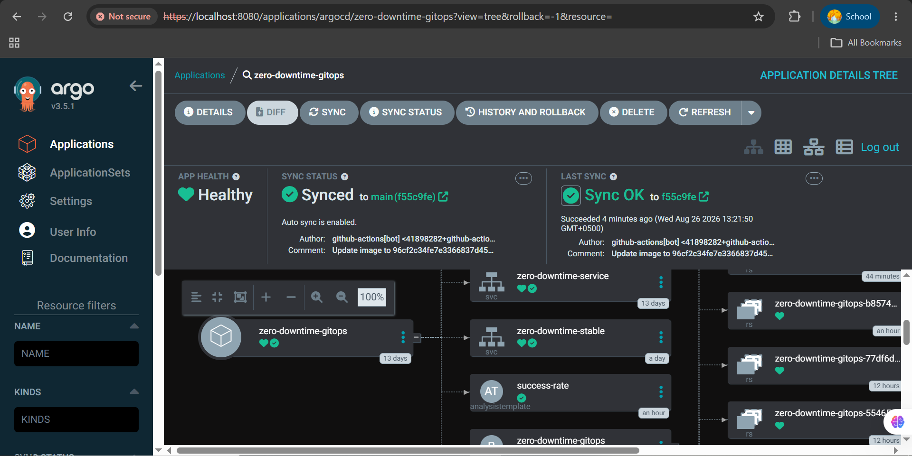
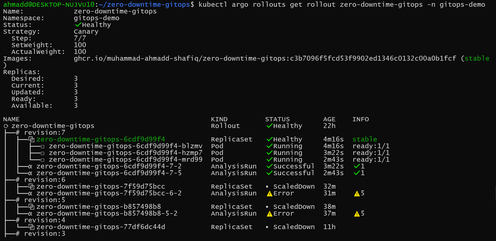
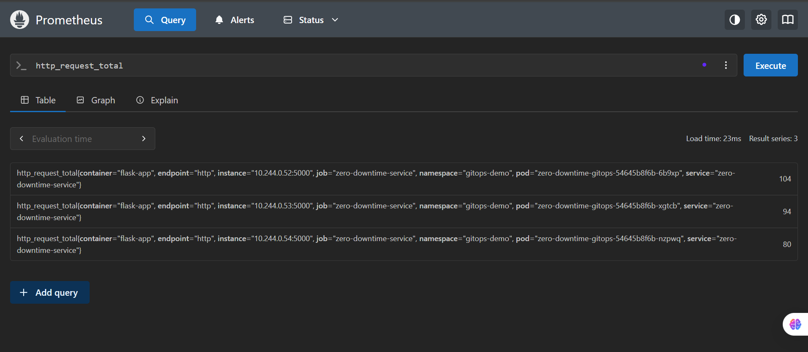
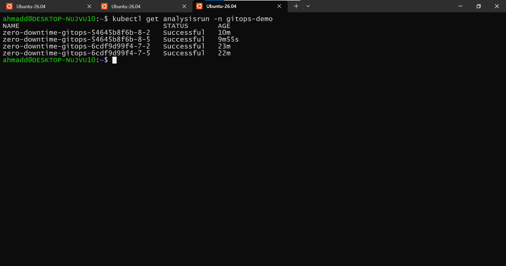

# Zero-Downtime GitOps Pipeline


Production-ready GitOps deployment platform built with Kubernetes, ArgoCD, Argo Rollouts, Prometheus, Grafana, GitHub Actions, and GitHub Container Registry (GHCR).

This project demonstrates how modern engineering teams safely deploy applications using automated CI/CD pipelines, canary releases, real-time monitoring, and metric-driven rollback strategies.

---

## Architecture

```text
Developer Push
      │
      ▼
GitHub Actions
(Test → Build → Push)
      │
      ▼
GHCR
(Container Registry)
      │
      ▼
ArgoCD
(GitOps Sync)
      │
      ▼
Kubernetes
      │
      ▼
Argo Rollouts
(Canary Deployment)
      │
      ▼
Prometheus Analysis
      │
      ├── Success → Promote Release
      │
      └── Failure → Abort Rollout
```

---

## Features

### GitOps Deployment

- Declarative Kubernetes manifests
- ArgoCD continuous reconciliation
- Self-healing cluster state
- Automatic synchronization from Git

### Continuous Integration

- GitHub Actions pipeline
- Automated testing with Pytest
- Docker image build and publishing
- Immutable image tags using commit SHA

### Progressive Delivery

- Argo Rollouts Canary Deployments
- Gradual rollout strategy
- Controlled production updates
- Safe application promotion

### Automated Rollback

- Prometheus-powered canary analysis
- Automated deployment validation
- Rollout abortion on failed metrics
- Stable version preservation

### Observability

- Prometheus metrics collection
- Application metrics endpoint
- Grafana dashboards
- Deployment visibility and monitoring

### Security

- Kubernetes Secrets
- Bitnami Sealed Secrets
- GitOps-friendly secret management
- Secure configuration storage

---

## Technology Stack

| Category | Technology |
|-----------|------------|
| CI/CD | GitHub Actions |
| Containerization | Docker |
| Registry | GitHub Container Registry (GHCR) |
| Orchestration | Kubernetes |
| GitOps | ArgoCD |
| Progressive Delivery | Argo Rollouts |
| Monitoring | Prometheus |
| Visualization | Grafana |
| Secret Management | Sealed Secrets |
| Application | Flask |
| Testing | Pytest |

---

## Repository Structure

```text
.
├── .github/
│   └── workflows/
│       └── ci-cd.yml
│
├── k8s/
│   ├── namespace.yaml
│   ├── configmap.yaml
│   ├── rollout.yaml
│   ├── service-stable.yaml
│   ├── service-canary.yaml
│   ├── analysis-template.yaml
│   ├── servicemonitor.yaml
│   └── sealed-secret.yaml
│
├── tests/
│   └── test_app.py
│
├── app.py
├── Dockerfile
├── requirements.txt
└── README.md
```

---

## Deployment Workflow

### 1. Code Push

A developer pushes changes to GitHub.

### 2. Continuous Integration

GitHub Actions automatically:

- Runs unit tests
- Builds a Docker image
- Pushes the image to GHCR

### 3. GitOps Synchronization

ArgoCD detects repository changes and synchronizes the cluster state.

### 4. Canary Deployment

Argo Rollouts progressively deploys the new version:

```yaml
steps:
  - setWeight: 25

  - analysis:
      templates:
      - templateName: success-rate

  - setWeight: 50

  - analysis:
      templates:
      - templateName: success-rate

  - setWeight: 100
```

### 5. Automated Analysis

Prometheus validates deployment health during rollout.

### 6. Automated Decision

If analysis succeeds:

- Release is promoted automatically

If analysis fails:

- Rollout is aborted
- Stable version remains active

---

## Monitoring

### Prometheus

Collects:

- Application metrics
- HTTP request metrics
- Kubernetes metrics
- Rollout analysis metrics

### Grafana

Visualizes:

- Cluster health
- Application performance
- Deployment status
- Rollout progress

---

## Application Endpoints

### Home

```http
GET /
```

### Health Check

```http
GET /health
```

### Version

```http
GET /version
```

### Metrics

```http
GET /metrics
```

---

## Example Rollout Validation

AnalysisTemplate executes Prometheus queries during deployment.

Successful validation:

```text
AnalysisRun: Successful
Rollout: Healthy
Promotion: Automatic
```

Failed validation:

```text
AnalysisRun: Failed
Rollout: Aborted
Stable Version: Preserved
```

---

## Screenshots

### GitHub Actions Pipeline

### ArgoCD Dashboard

### Argo Rollouts Canary Progress

### Prometheus Metrics

### Successful AnalysisRun


---

## Key Outcomes

- Zero-downtime deployments
- GitOps-based delivery
- Canary release strategy
- Automated deployment validation
- Metric-driven promotion
- Automated rollback protection
- Production-grade observability
- Secure secret management

---

## Future Improvements

- Helm Charts
- Terraform Infrastructure Provisioning
- Multi-Environment Deployments
- OpenTelemetry Tracing
- Service Mesh Integration
- Multi-Cluster GitOps

---

---

## License

This project is licensed under the **MIT License** see the [LICENSE](LICENSE) file for complete details.

---

## Author

<div align="center">

### **Muhammad Ahmad Shafiq**
*Cloud, Kubernetes & Platform Engineering Specialist*

[](https://github.com/muhammad-ahmadd-shafiq)
[](https://linkedin.com/in/muhammad-ahmadd-shafiq)

</div>
